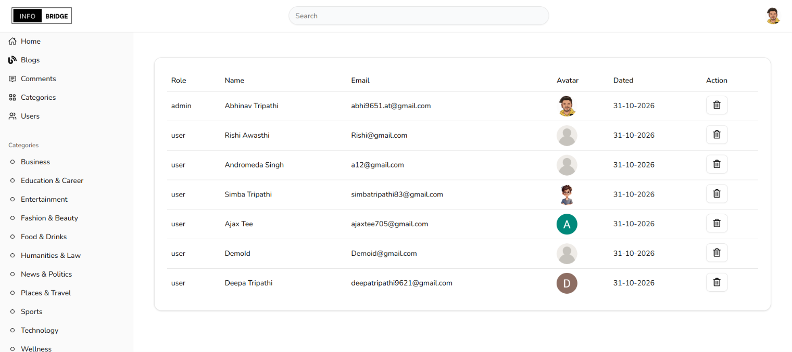

# 🌐 InfoBridge — Full Stack Blogging Platform

InfoBridge is a full-stack blogging platform built using the MERN stack. It provides a modern interface for creating, publishing, and managing blog content, along with an administrative dashboard for managing users, posts, categories, and comments.

## 📸 Application Preview

### Admin Dashboard



*Admin dashboard for managing blog content, users, categories, and comments.*

## ✨ Features

- **Admin Dashboard:** Centralized interface for managing blog content and application data.
- **Blog Management:** Create, edit, and manage blog posts.
- **User Management:** Manage registered users.
- **Category Management:** Organize blog posts into categories.
- **Comment Management:** Manage blog comments.
- **Rich Text Editor:** Create formatted blog content using CKEditor 5.
- **Image Uploads:** Handle media uploads using Multer and Cloudinary.
- **Authentication:** Authentication implementation using JWT and bcrypt.
- **Form Validation:** Manage and validate forms using React Hook Form and Zod.
- **Responsive UI:** Modern interface built with React, Tailwind CSS, and shadcn/ui.

## 🛠️ Tech Stack

### Frontend
- React 19
- JavaScript (ES6+)
- Vite 7
- Tailwind CSS 4
- shadcn/ui
- Radix UI
- Redux Toolkit
- React Redux
- Redux Persist
- React Router DOM 7
- React Hook Form
- Zod
- CKEditor 5
- Lucide React
- React Icons
- Axios (if used in the application)

### Backend
- Node.js
- Express.js 5
- MongoDB
- Mongoose 8
- JSON Web Token (JWT)
- Bcrypt.js
- Multer
- Cloudinary
- Cookie Parser
- CORS
- Dotenv

### Development Tools
- Git & GitHub
- Visual Studio Code
- ESLint
- Nodemon
- Vite

## 📁 Project Structure

```text
InfoBridge/
│
├── api/
│   ├── index.js
│   ├── package.json
│   └── ...
│
├── client/
│   ├── public/
│   │   └── screenshots/
│   │       └── admin-dashboard.png
│   ├── src/
│   ├── package.json
│   └── ...
│
├── .gitignore
└── README.md
```

## ⚙️ Installation & Setup

### 1. Clone the Repository

```bash
git clone https://github.com/abhinavtee/MERN-BLOG.git
cd MERN-BLOG
```

### 2. Backend Setup

Navigate to the backend directory:

```bash
cd api
npm install
```

Create a `.env` file inside the `api` directory and configure the environment variables required by your application.

Example:

```env
PORT=5000
MONGO_URI=your_mongodb_connection_string
JWT_SECRET=your_jwt_secret

CLOUDINARY_CLOUD_NAME=your_cloud_name
CLOUDINARY_API_KEY=your_api_key
CLOUDINARY_API_SECRET=your_api_secret
```

Start the backend development server:

```bash
npm run dev
```

### 3. Frontend Setup

Open another terminal and navigate to the frontend directory:

```bash
cd client
npm install
npm run dev
```

The frontend development server will start, usually at:

```text
http://localhost:5173
```

## 🔐 Environment Variables & Security

- Keep database credentials and API keys private.
- Never commit `.env` files to GitHub.
- Configure environment variables according to your actual application code.
- Use secure authentication and password-handling practices.

## 🚀 Future Improvements

- Advanced blog search and filtering.
- Improved dashboard analytics.
- Enhanced user experience and accessibility.
- Performance optimization.
- Additional responsive design improvements.

## 👨‍💻 Author

**Abhinav Tripathi**

- GitHub: [@abhinavtee](https://github.com/abhinavtee)
- LinkedIn: [Connect with me](https://www.linkedin.com/in/abhinavte/)

---

⭐ If you find InfoBridge interesting, feel free to explore the repository!